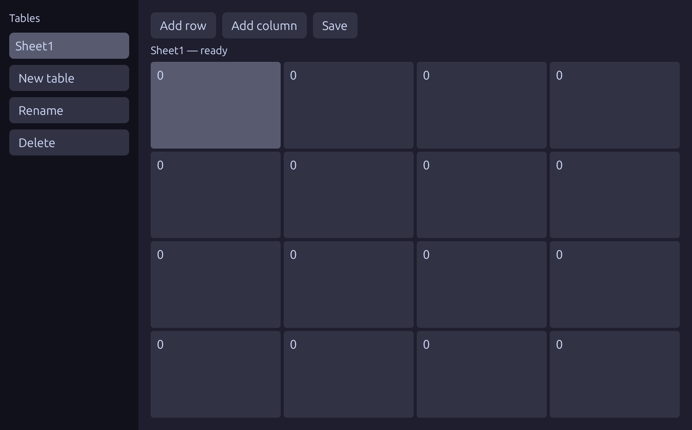

# Screenshots

These images are captured from the real GPUI renderer in headless mode, so they show the same
layout and styling as the desktop app without needing a display server.

## Current UI



The sidebar lists persisted tables, the grid shows the active table, and the title bar uses the
client-side decoration layout.

## Original spreadsheet MVP


This is the UI from PR #19: one editable 4x4 grid with cell editing and window controls.

## Regenerating a screenshot

The capture harness is an opt-in test named `capture_screenshot_when_requested` in
`sheetah-gpui/src/main.rs`. It does nothing unless `SHEETAH_SCREENSHOT_DIR` is set, so it is safe to
leave in the normal test suite.

From the workspace root, run the helper script:

```bash
scripts/capture-screenshot.sh multi-table.png
```

That writes `docs/screenshots/multi-table.png`. With no arguments it writes
`docs/screenshots/sheetah.png`; an optional second argument changes the output directory. Pass
`--keep-db` to preserve an existing database and capture a custom state:

```bash
scripts/capture-screenshot.sh custom.png /tmp/screenshots --keep-db
```

Under the hood, the script deletes `sheetah-gpui/sheetah.sqlite` (unless `--keep-db` is passed) so
the app seeds a fresh `Sheet1` 4x4 grid, sets `SHEETAH_SCREENSHOT_DIR` and
`SHEETAH_SCREENSHOT_NAME`, and runs the opt-in test. Those two variables enable capture and choose
the output path; the test is a no-op without `SHEETAH_SCREENSHOT_DIR`.

The harness uses `HeadlessAppContext` with the platform headless renderer, loads the app fonts,
opens a 900x560 client-decorated window, waits for startup to finish, then calls
`capture_screenshot` and saves the PNG. At 2x scaling the output is 1800x1120. Because the test runs
in `sheetah-gpui/`, the database it creates is `sheetah-gpui/sheetah.sqlite`.
